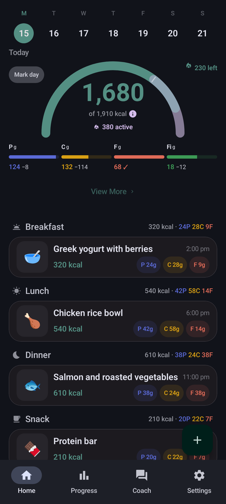
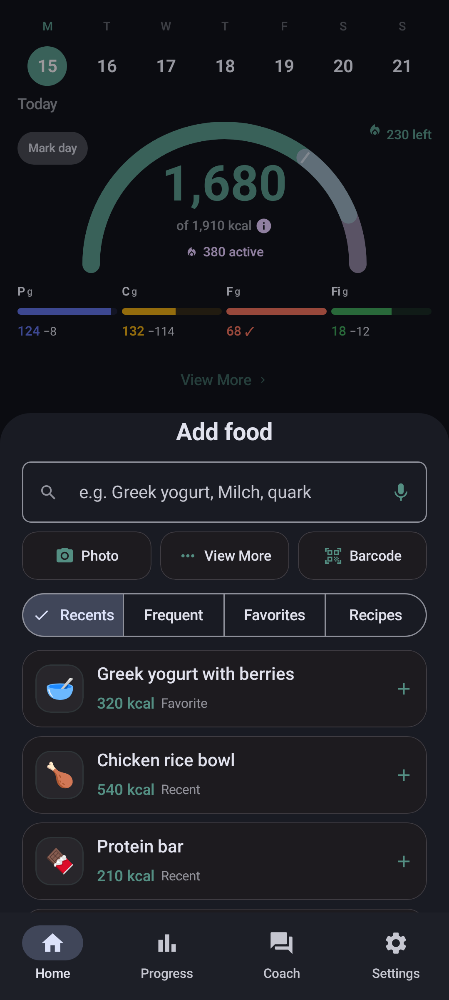
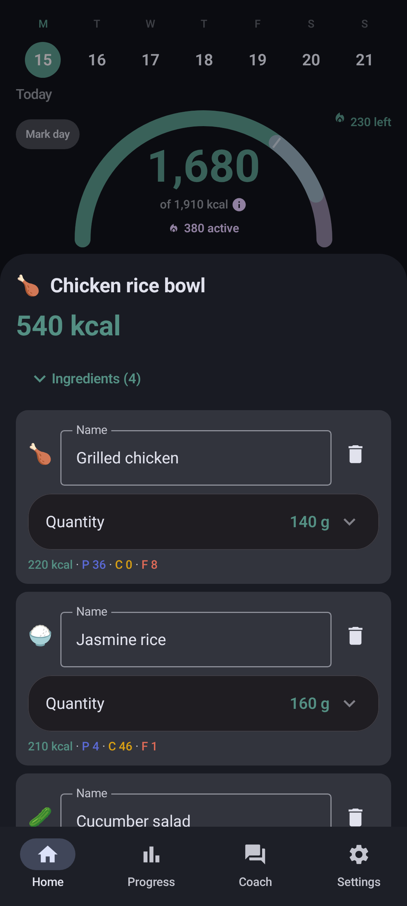
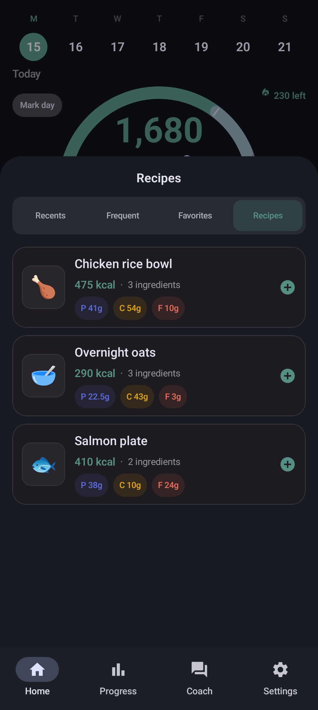
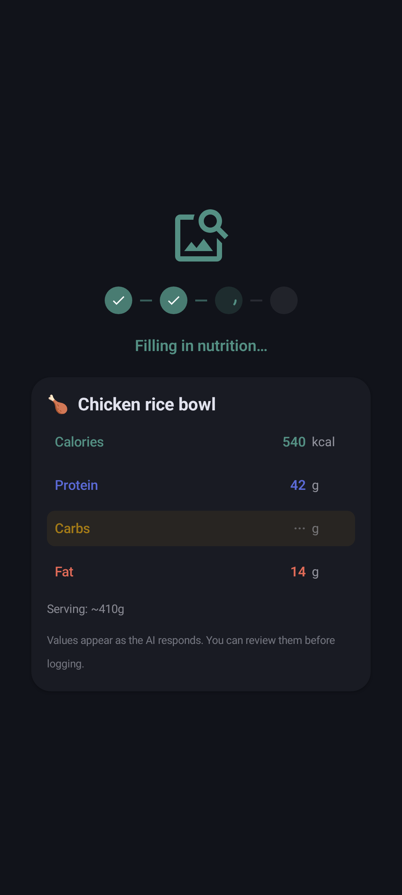
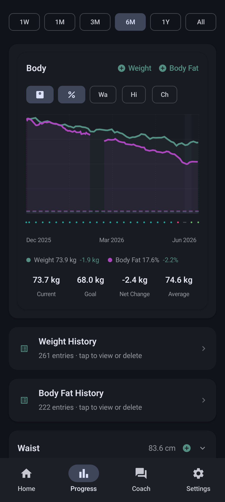
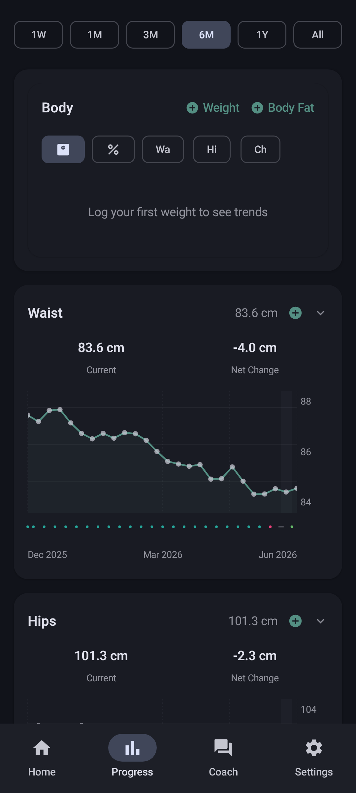
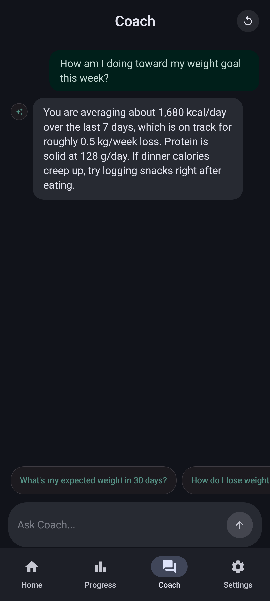

# Chompass (Форк от zavorateam)

**Приватный трекинг калорий для Android**

Используйте собственный ключ AI (включая бесплатные ключи от [Google AI Studio](https://aistudio.google.com/)). На Android вы также можете запускать Gemma 4 локально на устройстве. Полностью совместимо с **Google AI Studio Build**. Без рекламы, аналитики и аккаунтов.

> **Примечание:** Этот проект является форком, созданным и поддерживаемым **zavorateam** (на основе Chompass от fitguy и Fud AI от Apoorv Darshan).

[Веб-сайт](https://chompass.app/) · [Скачать](https://chompass.app/download/) · [Конфиденциальность](docs/PRIVACY.md)

Записывайте еду с помощью фото, голоса, штрихкода или текстовой заметки. Сканирование штрихкодов ищет продукты в [Open Food Facts](https://world.openfoodfacts.org/) (более 4.6 млн продуктов, кэшируется офлайн). Анализ фото также может считывать штрихкоды с изображений. Экспортируйте и импортируйте дневник, пользовательские базы данных продуктов и параметры тела в формате JSON.

## Установка

Приложение отсутствует в Play Store. Устанавливайте из **F-Droid**, Obtainium или Codeberg Releases.

&nbsp;&nbsp;

&nbsp;&nbsp;[](https://apps.obtainium.imranr.dev/redirect.html?r=obtainium%3A%2F%2Fapp%2F%7B%22id%22%3A%22app.chompass%22%2C%22url%22%3A%22https%3A%2F%2Fcodeberg.org%2Ffitguy%2Fchompass%22%2C%22author%22%3A%22fitguy%22%2C%22name%22%3A%22Chompass%20Beta%22%2C%22preferredApkIndex%22%3A0%2C%22additionalSettings%22%3A%22%7B%5C%22includePrereleases%5C%22%3Atrue%2C%5C%22fallbackToOlderReleases%5C%22%3Atrue%2C%5C%22filterReleaseTitlesByRegEx%5C%22%3A%5C%22-beta%5C%5C%5C%5C.%5C%22%2C%5C%22filterReleaseNotesByRegEx%5C%22%3A%5C%22%5C%22%2C%5C%22verifyLatestTag%5C%22%3Afalse%2C%5C%22useLatestAssetDateAsReleaseDate%5C%22%3Afalse%2C%5C%22releaseTitleAsVersion%5C%22%3Afalse%2C%5C%22trackOnly%5C%22%3Afalse%2C%5C%22versionExtractionRegEx%5C%22%3A%5C%22%5C%22%2C%5C%22matchGroupToUse%5C%22%3A%5C%22%5C%22%2C%5C%22versionDetection%5C%22%3Atrue%2C%5C%22releaseDateAsVersion%5C%22%3Afalse%2C%5C%22useVersionCodeAsOSVersion%5C%22%3Afalse%2C%5C%22apkFilterRegEx%5C%22%3A%5C%22%5EChompass-beta-%5C%22%2C%5C%22invertAPKFilter%5C%22%3Afalse%2C%5C%22autoApkFilterByArch%5C%22%3Atrue%2C%5C%22appName%5C%22%3A%5C%22Chompass%20Beta%5C%22%2C%5C%22shizukuPretendToBeGooglePlay%5C%22%3Afalse%2C%5C%22allowInsecure%5C%22%3Afalse%2C%5C%22exemptFromBackgroundUpdates%5C%22%3Afalse%2C%5C%22skipUpdateNotifications%5C%22%3Afalse%2C%5C%22about%5C%22%3A%5C%22%5C%22%7D%22%2C%22overrideSource%22%3Anull%7D)

- **F-Droid**: [app.chompass](https://f-droid.org/packages/app.chompass/). Установка и автообновление через клиент F-Droid.
- **Obtainium**: нажмите на бейдж выше, затем подтвердите. Или вставьте `https://codeberg.org/fitguy/chompass` в раздел **Add App**.
- **Бета-канал**: нажмите оранжевую кнопку **Obtainium Beta** для предрелизной ветки (теги `v<версия>-beta.N`, `Chompass-beta-*.apk`). Она существует параллельно со стабильной версией: бета-запись не содержит стабильных релизов, а стабильная — бета-версий. Бета-версии используют тот же ID пакета и versionCode, что и предшествующий стабильный релиз.

ID пакета релиза: `app.chompass`. Отладочная версия (из исходного кода): `app.chompass.debug`.

## Скриншоты

Тёмная тема Material 3 (светлая тема также доступна). Изображения находятся в [`docs/screenshots/`](docs/screenshots/).

<table>
  <tr>
    <td align="center" width="33%">
       
      <b>Главная</b>: кольцо калорий, КБЖУ, приёмы пищи
    </td>
    <td align="center" width="33%">
       
      <b>Добавить еду</b>: фото, голос, штрихкод, AI
    </td>
    <td align="center" width="33%">
       
      <b>Компоненты блюда</b>: редактирование ингредиентов и граммов
    </td>
  </tr>
  <tr>
    <td align="center" width="33%">
       
      <b>Рецепты</b>: сохранённые блюда из нескольких ингредиентов
    </td>
    <td align="center" width="33%">
       
      <b>Анализ AI</b>: этапы выполнения и потоковый вывод
    </td>
    <td align="center" width="33%">
       
      <b>Прогресс</b>: вес, шаги, цели
    </td>
  </tr>
  <tr>
    <td align="center" width="33%">
       
      <b>Графики прогресса</b>: наглядные тренды замеров тела
    </td>
    <td align="center" width="33%">
       
      <b>Консультант</b>: чат с вашим собственным ключом
    </td>
    <td align="center" width="33%">
       
      <b>Настройки</b>: провайдеры, цели, данные
    </td>
  </tr>
</table>

## Возможности

### Ведение дневника

- **Запись еды**: фото (до 10), голос, штрихкод, текст, ручной ввод, компоненты блюда, рецепты, сохранённые приёмы пищи, восстановление черновиков. Поддерживает отправку через системное меню «Поделиться».
- **Штрихкод**: поиск в [Open Food Facts](https://world.openfoodfacts.org/) (4.6M+ продуктов, кэширование офлайн). Считывает EAN, QR и Data Matrix с помощью FOSS библиотеки [zxing-cpp](https://github.com/zxing-cpp/zxing-cpp).
- **Поиск продуктов**: живой поиск Open Food Facts плюс офлайн-индексы USDA и швейцарской базы состава продуктов.

### Искусственный интеллект (AI)

- **AI**: ваш собственный облачный ключ (бесплатного ключа [Google AI Studio](https://aistudio.google.com/apikey) вполне достаточно для повседневного использования). Пошаговый прогресс и предварительный просмотр полей в реальном времени. Чат Консультанта. Все функции AI можно отключить; штрихкоды, поиск и ручной ввод продолжат работать.
- **Локальный AI на устройстве**: опциональная модель **On-Device (Private)** Gemma 4. Подробнее ниже.

### Прогресс и трекеры

- **Прогресс**: вес, процент жира, замеры тела, прогноз. Кето и другие диетические режимы. Трекинг воды.
- **Дополнительные трекеры**: вода, никотин, кофеин, таймер голодания и дневные заметки. Каждый из них отключён по умолчанию. Данные голодания остаются только на устройстве и никогда не экспортируются и не синхронизируются.

### Данные, экспорт и синхронизация

- **Экспорт и синхронизация**: экспорт дневника (JSON / Markdown / CSV), импорт/экспорт веса и замеров тела, экспорт/импорт пользовательских баз данных продуктов (JSON), массовый импорт JSON, ссылки для отправки приёмов пищи. Опциональная синхронизация **WebDAV** на вашем собственном сервере (без бэкенда Chompass).

### Языки

- **Языки**: 18.

### Интеграция с Android

- **Динамический бюджет калорий**: в режиме «Добавлять активность» кольцо на главном экране увеличивает дневную цель на величину сожжённых за день калорий (Health Connect, ручной ввод или оценка по вашей истории). Виджеты используют тот же бюджет.
- **Health Connect**: шаги, тренировки, сон, пульс, гидратация. Двусторонняя синхронизация с Gadgetbridge, openScale и другими приложениями Health Connect.
- **Виджеты и уведомления**
- **Размер**: ~17 МБ arm64 / ~29 МБ универсальный. Без рекламы, аналитики или библиотек тренировок.

## Локальный AI на устройстве

Откройте **Настройки → AI и Речь** и выберите **На устройстве (Приватно)**. AI для записи еды будет работать прямо на телефоне. API ключ не требуется, и ничего не отправляется облачному провайдеру для анализа текста или фото.

|                      |                                                                                                                                       |
| -------------------- | ------------------------------------------------------------------------------------------------------------------------------------- |
| **Модели**           | [Gemma 4 Edge](https://developers.google.com/edge/litert-lm/android) (E2B ~2.4 ГБ или E4B ~3.4 ГБ), скачивается один раз с Hugging Face |
| **Что остаётся локально** | Анализ текста и фото еды                                                                                                          |
| **Требования**     | arm64, 6 ГБ+ ОЗУ (скрыто на неподдерживаемых устройствах)                                                                                |
| **Точность**         | Модели на устройстве значительно меньше облачных и могут ошибаться в порциях, брендах и фото. Облачный AI предпочтителен по умолчанию.  |
| **Резервный вариант** | Включите **Резервный провайдер**, чтобы облачная модель повторила попытку при ошибке локального AI                                     |

Чат Консультанта по-прежнему требует облачного провайдера.

## Health Connect

Без сторонних SDK и дополнительного аккаунта. Приложения, записывающие данные в Health Connect, могут передавать их в Chompass:

| Совместимое приложение                                            | Что передаёт                                      | Примечания                                                       |
| ------------------------------------------------------------------ | ------------------------------------------------- | ---------------------------------------------------------------- |
| [Gadgetbridge](https://gadgetbridge.org/)                          | Шаги, тренировки, вес с носимых устройств        | FOSS; включите _Настройки → Внешние интеграции → Health Connect_ |
| [openScale](https://f-droid.org/en/packages/com.health.openscale/) | Вес и состав тела с Bluetooth-весов              | FOSS, доступно в F-Droid                                         |
| Samsung Health, Fitbit, Withings и др.                             | Вес, активность, сожжённая энергия               | Через синхронизацию каждого приложения с Health Connect          |

| Направление | Данные                                                                                       |
| ----------- | -------------------------------------------------------------------------------------------- |
| **Вход**    | Вес и жир, приёмы пищи из других приложений, шаги и тренировки, сон, пульс покоя, гидратация, энергия |
| **Выход**   | Каждый приём пищи, а также вес, процент жира и рост                                          |

Опциональная **фоновая синхронизация** (Настройки → Здоровье и данные, выключена по умолчанию) считывает Health Connect каждые несколько часов при закрытом приложении на поддерживаемых устройствах.

На Android 14 и новее Health Connect является системным модулем. В некоторых сборках без сервисов Google он отображается в Настройках, но приложения не могут его использовать. В таком случае используйте экспорт/импорт файлов или WebDAV. Huawei Health Kit не поддерживается; подключайте носимое устройство через [Gadgetbridge](https://gadgetbridge.org/).

## Насколько точен AI?

Точность зависит от выбранной модели. Приложение не заявляет единое число. Мы проводим тестирования на размеченных датасетах и публикуем результаты.

Текстовый ввод с указанием порции: **5.7% WMAPE, 90% в пределах ±20%** от точной калорийности. Оценка по фото является сложной задачей для всех протестированных нами визуальных моделей (лучшая платная модель: **32.3% WMAPE, 50% в пределах ±20%**). Полные данные: [`docs/ACCURACY.md`](docs/ACCURACY.md).

## Документация

- [Руководство по настройкам](https://chompass.app/settings/): описание всех настроек
- [`docs/ACCURACY.md`](docs/ACCURACY.md): что означают показатели AI
- [`docs/PRIVACY.md`](docs/PRIVACY.md): без рекламы, без аналитики, локальное хранение
- [`docs/CALCULATION_METHODS.md`](docs/CALCULATION_METHODS.md): BMR, TDEE, цели, вода
- [`docs/README.md`](docs/README.md): полный индекс документации

## Миграция с Fud AI

Chompass основан на [Fud AI](https://github.com/apoorvdarshan/fud-ai). JSON дневника из Fud AI импортируется сюда.

| Способ                | Инструкция                                                                                             |
| --------------------- | ------------------------------------------------------------------------------------------------------ |
| **Экспорт файла**     | В Fud AI экспортируйте дневник питания в JSON. В Chompass откройте **Настройки → Импорт JSON дневника** |
| **Health Connect**    | Включите Health Connect в обоих приложениях и предоставьте разрешения на чтение                        |

Раздел **Настройки → Импорт данных веса и тела** также принимает файлы JSON/CSV Chompass, CSV [openScale](https://f-droid.org/en/packages/com.health.openscale/) и обычные CSV веса. Параметры замеров тела не имеют типа записей в Health Connect, поэтому для них используйте передачу файлов.

| Возможность             | [Fud AI](https://github.com/apoorvdarshan/fud-ai) | Chompass Android                          |
| ----------------------- | ------------------------------------------------- | ----------------------------------------- |
| Рекламные баннеры       | Были в AdMob; удалены в 3.0.3                      | **Никогда не было**                       |
| Локальный AI (Gemma 4)  | Нет                                               | **Да** (по желанию)                       |
| Штрихкод                | ML Kit                                            | **FOSS zxing-cpp**                        |
| Библиотека тренировок   | Да (~120 МБ APK)                                  | **Исключена** (~17 МБ arm64)              |
| Кето / режимы диеты     | Нет                                               | **Да**                                    |
| Health Connect          | Частично                                          | **Шаги, тренировки, сон, пульс, гидратация** |
| Виджеты / уведомления   | Базовый набор                                     | **Да**                                    |
| Языки                   | Базовый набор                                     | **18**                                    |
| Дистрибуция             | Ориентировано на Play Store                       | **F-Droid** / Obtainium / Codeberg        |
| Открытый JSON дневника  | Форматы оригинала                                 | **Да**                                    |

Источники: [Релизы Fud AI](https://github.com/apoorvdarshan/fud-ai/releases), [Релизы Chompass](https://codeberg.org/fitguy/chompass/releases). Матрица поддержки: [`docs/PARITY.md`](docs/PARITY.md). История изменений: [`docs/CHANGELOG.md`](docs/CHANGELOG.md).

## Конфиденциальность

Без рекламы, аналитики и трекинг SDK. Записи еды, замеры тела и чат Консультанта остаются на устройстве, если вы не экспортируете их, не синхронизируете через Health Connect или не используете WebDAV. Запросы к облачному AI отправляются только выбранному вами провайдеру. Ключи API шифруются при хранении и не передаются на серверы Chompass. Режим **On-Device (Private)** выполняет анализ еды прямо на телефоне.

Полная политика: [PRIVACY.md](docs/PRIVACY.md). Индекс документации: [`docs/README.md`](docs/README.md). Сборка из исходного кода: [`CONTRIBUTING.md`](CONTRIBUTING.md).

## Поддержка

Chompass — бесплатное приложение с открытым исходным кодом без рекламы. Если вы хотите сказать спасибо, вы можете [угостить fitguy йогуртом](https://ko-fi.com/fitguy) на Ko-fi.

## Авторские права и лицензия

Chompass основан на [Fud AI](https://github.com/apoorvdarshan/fud-ai). Данный репозиторий является форком, созданным **zavorateam**.

- Copyright (c) 2026 Apoorv Darshan - [Лицензия MIT](LICENSE)
- Модификации Copyright (c) 2026 fitguy - Лицензия MIT
- Модификации форка Copyright (c) 2026 zavorateam - Лицензия MIT

См. также [NOTICE](docs/NOTICE.md) и [ASSET_CREDITS.md](docs/ASSET_CREDITS.md).
